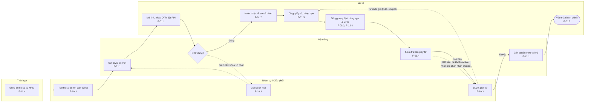
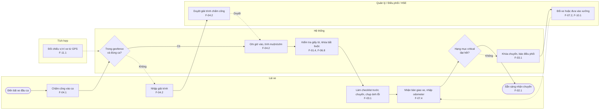
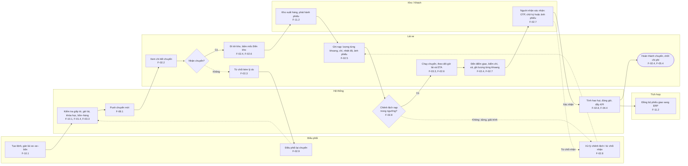
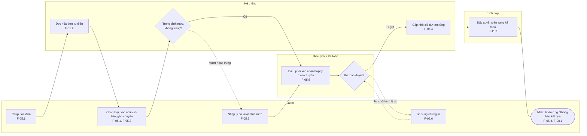
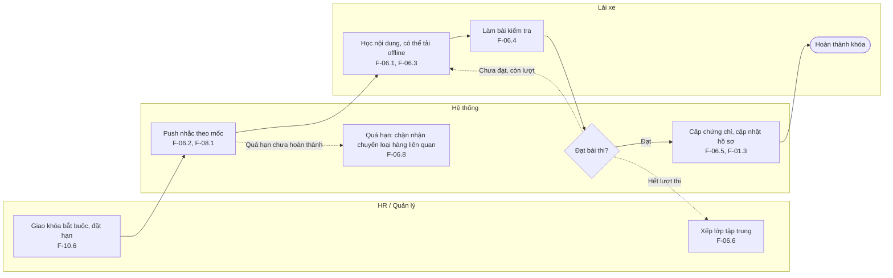
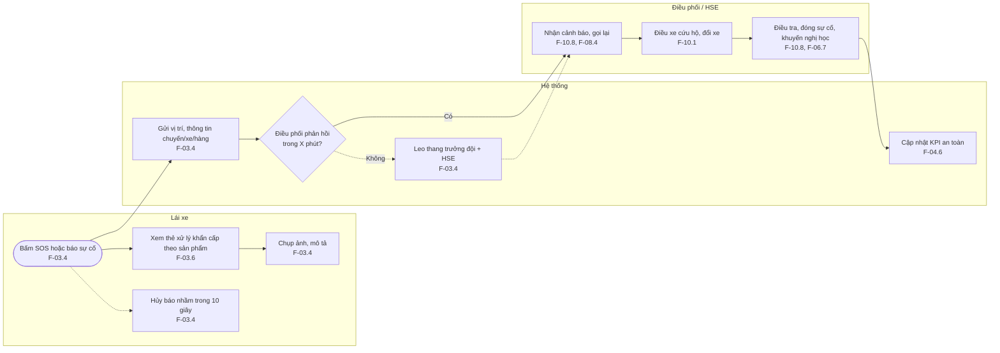
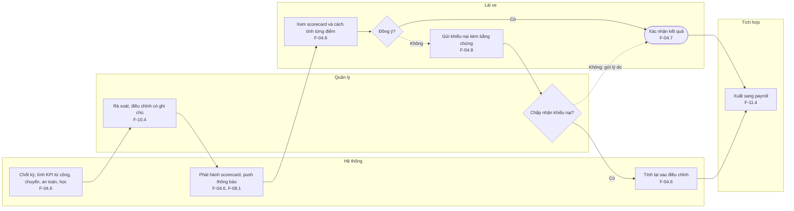

# DriverOS — Requirements (Feature list, User flow, Open items)

> Phiên bản 0.1 · 2026-11-12 · Nguồn: mô tả bằng lời của người dùng (chưa có BRD).
> Đây là bản nháp để review. Mọi giả định nằm ở mục **Giả định** và **Open items** — cần chốt trước khi vào thiết kế chi tiết.

---

## 1. Tổng quan

**DriverOS** là ứng dụng di động (kèm web back-office) cho **nhân viên lái xe chuyên chở dầu** (xe bồn xăng dầu). App giúp lái xe nhận và thực hiện chuyến, chấm công, theo dõi KPI, kê khai chi phí và học tập. Phía công ty, điều phối viên / quản lý / kế toán dùng web để giao việc, duyệt và theo dõi.

Hai điểm khác biệt so với một app quản lý tài xế thông thường:

1. **Hàng nguy hiểm** → an toàn và tuân thủ (giấy phép, chứng chỉ, giờ lái, niêm phong, xử lý sự cố) không phải tính năng phụ mà là **điều kiện chặn** (gate) cho việc nhận chuyến.
2. **Hao hụt** (chênh lệch lượng nạp – lượng giao) là rủi ro tiền bạc lớn nhất của ngành dầu → phải được ghi nhận có cấu trúc ở từng khoang và đưa vào KPI.

### Giả định đang dùng (chưa xác nhận)

| # | Giả định | Nếu sai thì ảnh hưởng |
|---|---|---|
| A1 | "Chở dầu" = xe bồn chở xăng dầu thành phẩm, **mỗi xe nhiều khoang**. "Bao nhiêu thùng" hiểu là **số khoang/lượng từng khoang**. Mô hình dữ liệu hỗ trợ cả phuy/thùng rời. | Mô hình dữ liệu F-02.2, F-02.5, F-02.7 |
| A2 | Có cả lái xe **biên chế** và **thuê ngoài/hợp đồng**, và có **phụ xe** ở một số chuyến. | Ma trận persona, EP-04, EP-05 |
| A3 | Lái xe dùng **smartphone** (công ty cấp hoặc cá nhân), có vùng mất sóng → cần **offline-first**. | F-12.2, mọi luồng ngoài đường |
| A4 | Có điều phối viên con người giao việc; lệnh xuất hàng đến từ hệ thống kho/TMS/ERP hoặc nhập tay. | EP-10, EP-11 |
| A5 | Giai đoạn đầu **một công ty, vài đội xe**; chưa multi-tenant. | Kiến trúc, F-12.1 |

---

## 2. Persona

| Persona | Vai trò | Khối lượng / tần suất | Kênh tương tác | Ràng buộc đặc thù |
|---|---|---|---|---|
| **Lái xe biên chế** | Người dùng chính, thực hiện chuyến | 1–3 chuyến/ca, dùng app nhiều lần/ngày nhưng mỗi lần ngắn, thường **một tay, ngoài trời, mạng yếu** | App mobile | Lương có phần gắn KPI; chịu quy định giờ lái; không được thao tác khi xe chạy |
| **Lái xe thuê ngoài** | Lái xe của nhà thầu vận tải | Theo chuyến, không cố định ca | App mobile (bản rút gọn) | Tính tiền theo cước/chuyến; hồ sơ do nhà thầu cấp; hết hợp đồng thì phải khóa quyền |
| **Phụ xe** | Hỗ trợ nạp/xả, đồng kiểm | Chỉ có ở một số chuyến | App mobile (rút gọn) | Không lái → không chịu giờ lái; vẫn cần chứng chỉ hàng nguy hiểm |
| **Điều phối viên** | Tạo lệnh, phân công, xử lý phát sinh | Hàng trăm thao tác/ngày | Web back-office | Phải đảm bảo "đúng người – đúng xe – đúng hàng"; chịu SLA giao hàng |
| **Quản lý đội xe** | Đánh giá, duyệt ngoại lệ, KPI | Hàng ngày/tuần | Web + mobile (xem nhanh) | Chịu trách nhiệm KPI đội |
| **Kế toán** | Duyệt chi phí, tạm ứng, quyết toán | Theo đợt/tuần | Web | Cần hóa đơn hợp lệ, đối soát nhiên liệu |
| **HR / Đào tạo** | Hồ sơ, chấm công cuối tháng, khóa học | Theo tháng/quý | Web | Cần hạn giấy tờ, chứng chỉ chính xác |
| **HSE (an toàn)** | Giám sát tuân thủ, xử lý sự cố | Khi có sự cố + kiểm tra định kỳ | Web + nhận cảnh báo | Chịu trách nhiệm pháp lý về an toàn hàng nguy hiểm |
| **Kho / khách nhận hàng** (external) | Xác nhận lượng nạp/xả | Mỗi chuyến | Không cài app: **OTP/chữ ký/ảnh phiếu** | Có thể không có smartphone |

Hệ thống tích hợp: GPS/giám sát hành trình, hệ thống kho/TMS/ERP, kế toán, HRM/payroll, bản đồ.

---

## 3. Feature list

Ký hiệu priority: **M** Must · **S** Should · **C** Could. Phase gợi ý: **P1** MVP · **P2** · **P3**.
Source ref: R-số trỏ về mục [Traceability](#6-traceability).

### EP-01 · Tài khoản & Hồ sơ lái xe
| ID | Feature | Mô tả | Persona | Pri | Phase | Ref |
|---|---|---|---|---|---|---|
| F-01.1 | Kích hoạt & đăng nhập | Nhận lời mời, xác thực OTP, đặt PIN/sinh trắc; khóa tạm khi sai nhiều lần | Tất cả lái/phụ xe | M | P1 | R1 |
| F-01.2 | Xem và cập nhật hồ sơ cá nhân | Thông tin cơ bản, liên hệ khẩn cấp, tài khoản nhận lương; trường nhạy cảm cần duyệt | Lái xe | M | P1 | R1 |
| F-01.3 | Quản lý giấy tờ & chứng chỉ | GPLX (hạng), giấy phép/huấn luyện vận chuyển hàng nguy hiểm, khám sức khỏe, chứng chỉ ATGT; ảnh + ngày hết hạn | Lái xe, HR | M | P1 | R1 |
| F-01.4 | Cảnh báo hết hạn & chặn nhận chuyến | Nhắc trước N ngày; giấy tờ/chứng chỉ bắt buộc hết hạn → không được phân công/nhận chuyến | Lái xe, Điều phối | M | P1 | R1, R2 |
| F-01.5 | Màn hình chính cá nhân | Chuyến hôm nay, nhắc việc, KPI tóm tắt, hạn giấy tờ | Lái xe | S | P1 | R1 |

### EP-02 · Chuyến & công việc vận chuyển
| ID | Feature | Mô tả | Persona | Pri | Phase | Ref |
|---|---|---|---|---|---|---|
| F-02.1 | Danh sách chuyến | Hôm nay / sắp tới / lịch sử, lọc theo trạng thái | Lái xe | M | P1 | R2 |
| F-02.2 | Chi tiết lệnh chuyến | **Chở đi đâu**: điểm lấy, điểm giao, sản phẩm, lượng. **Bao nhiêu thùng**: cấu hình khoang/phuy và lượng từng khoang. Khung giờ, liên hệ, lưu ý an toàn | Lái xe | M | P1 | R2, R3, R4 |
| F-02.3 | Nhận / từ chối chuyến | Nhận có xác nhận; từ chối bắt buộc lý do; hết hạn phản hồi thì tự chuyển điều phối | Lái xe | M | P1 | R2 |
| F-02.4 | Cập nhật mốc chuyến | Đến kho → bắt đầu nạp → nạp xong → rời kho → đến điểm giao → bắt đầu xả → xả xong → hoàn thành. Mỗi mốc có thời gian + vị trí | Lái xe | M | P1 | R2, R4 |
| F-02.5 | Ghi nhận nạp hàng | Lượng thực nạp từng khoang, số chì niêm phong, nhiệt độ/tỷ trọng (nếu có), ảnh phiếu xuất | Lái xe, Phụ xe | M | P1 | R3 |
| F-02.6 | Dẫn đường & ETA | Mở bản đồ tới điểm kế tiếp, ETA, cảnh báo tuyến cấm/hạn chế với xe hàng nguy hiểm | Lái xe | S | P2 | R4 |
| F-02.7 | Giao hàng & xác nhận nhận hàng | Kiểm niêm phong, ghi lượng thực xả từng khoang, người nhận xác nhận bằng OTP/chữ ký/ảnh phiếu | Lái xe, Khách | M | P1 | R3, R4 |
| F-02.8 | Chênh lệch & bất thường | Tự tính hao hụt nạp–xả; vượt ngưỡng bắt buộc giải trình; báo từ chối nhận, chờ lâu, sai niêm phong | Lái xe, Điều phối | M | P1 | R3 |
| F-02.9 | Điều chỉnh chuyến từ điều phối | Đổi điểm giao, hủy, ghép chuyến; lái xe được thông báo và phải xác nhận | Lái xe, Điều phối | M | P1 | R2 |
| F-02.10 | Theo dõi thời gian chờ | Tự đo thời gian chờ nạp/xả để làm căn cứ khiếu nại và KPI | Lái xe | C | P3 | R2 |

### EP-03 · An toàn & tuân thủ (nhóm tài liệu gốc không nhắc nhưng là bắt buộc với hàng nguy hiểm)
| ID | Feature | Mô tả | Persona | Pri | Phase | Ref |
|---|---|---|---|---|---|---|
| F-03.1 | Checklist trước chuyến | Xe, bồn, van, PCCC, bảo hộ, tình trạng sức khỏe; **hạng mục critical không đạt → khóa bắt đầu chuyến** | Lái xe, Phụ xe | M | P1 | R10 |
| F-03.2 | Checklist cuối chuyến / bàn giao | Tình trạng xe, odometer, vệ sinh bồn, ảnh | Lái xe | S | P2 | R10 |
| F-03.3 | Theo dõi giờ lái & nhắc nghỉ | Cộng dồn giờ lái liên tục/ngày, nhắc nghỉ, chặn phân công khi vượt (ngưỡng theo quy định, cần pháp chế xác nhận) | Lái xe, Điều phối | M | P2 | R10 |
| F-03.4 | Báo sự cố & SOS | Một chạm: gửi vị trí + thông tin chuyến/xe/hàng; chụp ảnh, mô tả; gọi hotline | Lái xe | M | P1 | R10 |
| F-03.5 | Cảnh báo vi phạm từ GPS | Quá tốc độ, dừng đỗ sai khu vực; đẩy vào KPI | Lái xe, Quản lý | S | P2 | R5, R10 |
| F-03.6 | Thẻ xử lý khẩn cấp offline | Hướng dẫn xử lý rò rỉ/cháy theo từng loại sản phẩm, dùng được khi mất sóng | Lái xe | S | P2 | R10 |

### EP-04 · Chấm công & KPI
| ID | Feature | Mô tả | Persona | Pri | Phase | Ref |
|---|---|---|---|---|---|---|
| F-04.1 | Chấm công vào/ra ca | GPS geofence tại bãi/kho + giờ server; chống giả GPS cơ bản | Lái xe | M | P1 | R5, R6 |
| F-04.2 | Quy tắc muộn/sớm & giải trình | Tính đi muộn / về sớm / **đến sớm** theo ca đã định; ngoài geofence hoặc sai giờ → giải trình, quản lý duyệt | Lái xe, Quản lý | M | P1 | R5, R6 |
| F-04.3 | Bảng công tháng | Xem, đối chiếu, gửi khiếu nại dòng sai | Lái xe, HR | M | P1 | R5, R6 |
| F-04.4 | Đúng giờ theo chuyến | So sánh giờ xuất bến/giờ giao thực tế với khung giờ hẹn | Lái xe, Điều phối | M | P2 | R5, R6 |
| F-04.5 | Xin nghỉ / đổi ca / OT | Tạo đề xuất, duyệt, cập nhật vào công | Lái xe, Quản lý | S | P2 | R5 |
| F-04.6 | Scorecard KPI cá nhân | Đúng giờ, chuyên cần, hao hụt, tiêu hao nhiên liệu, vi phạm, sự cố, tuân thủ checklist, hoàn thành học tập; xem được **cách tính từng điểm** | Lái xe | M | P2 | R5, R6 |
| F-04.7 | Xếp hạng & thưởng/phạt | Quy tắc quy đổi KPI ra thưởng/phạt, bảng xếp hạng đội | Lái xe, Quản lý | S | P3 | R5, R6 |
| F-04.8 | Khiếu nại KPI | Gửi khiếu nại kèm bằng chứng, trong hạn, theo dõi kết quả | Lái xe, Quản lý | S | P2 | R5, R6 |

### EP-05 · Tài chính & chi phí
| ID | Feature | Mô tả | Persona | Pri | Phase | Ref |
|---|---|---|---|---|---|---|
| F-05.1 | Kê khai chi phí chuyến | Loại: ăn uống, cầu đường/phí, bến bãi, rửa xe, sửa nhỏ, khác; chụp hóa đơn; gắn vào chuyến | Lái xe | M | P1 | R7 |
| F-05.2 | OCR hóa đơn | Tự điền ngày, số tiền, nhà cung cấp, MST từ ảnh | Lái xe | C | P3 | R7, R8 |
| F-05.3 | Ghi nhận đổ nhiên liệu | Lít, đơn giá, trạm, odometer; phân biệt đổ ngoài trạm và lấy từ kho nội bộ/thẻ xăng | Lái xe | M | P1 | R8 |
| F-05.4 | Tạm ứng & quyết toán chuyến | Số dư tạm ứng, hoàn ứng, quyết toán cuối chuyến | Lái xe, Kế toán | M | P1 | R7, R8 |
| F-05.5 | Chính sách & định mức | Định mức ăn/ngày, hạn mức theo loại; cảnh báo ngay khi vượt | Lái xe, Kế toán | M | P1 | R7, R8 |
| F-05.6 | Luồng duyệt chi phí | Điều phối xác nhận hợp lý theo chuyến → kế toán duyệt; từ chối kèm lý do, cho bổ sung | Kế toán, Điều phối | M | P1 | R7, R8 |
| F-05.7 | Xem thu nhập | Lương chuyến, phụ cấp, khấu trừ, phiếu lương (chỉ biên chế) | Lái xe biên chế | S | P3 | R7 |
| F-05.8 | Đối soát nhiên liệu | So lít đổ với km thực chạy và định mức, gắn cờ bất thường | Kế toán, Quản lý | S | P3 | R8 |

### EP-06 · Học tập & đào tạo
| ID | Feature | Mô tả | Persona | Pri | Phase | Ref |
|---|---|---|---|---|---|---|
| F-06.1 | Danh mục & lộ trình | Khóa học theo vai trò và loại hàng | Lái xe, Phụ xe | M | P2 | R9 |
| F-06.2 | Khóa bắt buộc có hạn | ATGT, PCCC, hàng nguy hiểm, quy trình nạp/xả; có deadline và nhắc | Lái xe, HR | M | P2 | R9 |
| F-06.3 | Học dạng ngắn, tải offline | Video/ảnh/PDF/audio ngắn, tải trước khi vào vùng mất sóng | Lái xe | S | P2 | R9 |
| F-06.4 | Bài kiểm tra | Điểm đạt, giới hạn số lần thi, lịch sử | Lái xe | M | P2 | R9 |
| F-06.5 | Chứng chỉ nội bộ | Đạt bài thi → tự cập nhật vào hồ sơ (F-01.3) | Lái xe, HR | S | P2 | R9 |
| F-06.6 | Lớp tập trung | Đăng ký lớp offline, điểm danh | Lái xe, HR | S | P3 | R9 |
| F-06.7 | Học gắn sự cố | Đề xuất khóa học sau vi phạm/sự cố | Lái xe, HSE | C | P3 | R9 |
| F-06.8 | Chặn theo đào tạo | Chưa đạt khóa bắt buộc → hạn chế nhận chuyến loại hàng tương ứng | Điều phối | S | P2 | R9, R2 |

### EP-07 · Xe & thiết bị
| ID | Feature | Mô tả | Persona | Pri | Phase | Ref |
|---|---|---|---|---|---|---|
| F-07.1 | Xe/bồn được gán | Biển số, cấu hình khoang, hạn đăng kiểm/kiểm định bồn | Lái xe | M | P1 | R2, R10 |
| F-07.2 | Báo hỏng & yêu cầu sửa | Mô tả, ảnh, mức độ; điều phối đổi xe hoặc đưa vào xưởng | Lái xe, Điều phối | M | P1 | R10 |
| F-07.3 | Nhắc bảo dưỡng/đăng kiểm | Lịch và cảnh báo theo km/ngày | Lái xe, Quản lý | S | P3 | R10 |
| F-07.4 | Bàn giao xe giữa ca | Tình trạng, odometer, ảnh, xác nhận hai bên | Lái xe | S | P2 | R10 |

### EP-08 · Thông báo & liên lạc
| ID | Feature | Mô tả | Persona | Pri | Phase | Ref |
|---|---|---|---|---|---|---|
| F-08.1 | Push notification | Chuyến mới/đổi, duyệt chi phí, nhắc giấy tờ/học | Tất cả | M | P1 | R2, R10 |
| F-08.2 | Nhắn nhanh với điều phối | Mẫu câu có sẵn, giọng nói; **khóa gõ khi xe đang chạy** | Lái xe, Điều phối | S | P2 | R10 |
| F-08.3 | Bản tin & xác nhận đã đọc | Quy định/thông báo nội bộ, bắt buộc xác nhận với nội dung quan trọng | Lái xe, HR | S | P2 | R10 |
| F-08.4 | Gọi nhanh | Điều phối, HSE, hotline sự cố | Lái xe | M | P1 | R10 |

### EP-09 · Công việc khác
| ID | Feature | Mô tả | Persona | Pri | Phase | Ref |
|---|---|---|---|---|---|---|
| F-09.1 | Nhiệm vụ ngoài chuyến | Điều phối giao việc phát sinh: đưa xe đi sửa, đăng kiểm, rửa bồn, lấy mẫu… có hạn và xác nhận hoàn thành | Lái xe, Điều phối | S | P2 | R10 |
| F-09.2 | Lịch cá nhân tổng hợp | Ca, chuyến, lớp học, hạn giấy tờ trên một lịch | Lái xe | S | P2 | R10 |
| F-09.3 | Yêu cầu hành chính | Giấy xác nhận công tác/thu nhập, đổi thông tin | Lái xe, HR | C | P3 | R10 |
| F-09.4 | Khảo sát & góp ý | Phản hồi về ô tô, quy trình, điều kiện làm việc | Lái xe | C | P3 | R10 |
| F-09.5 | Thông tin phúc lợi & bảo hiểm | Quy định, quy trình khi tai nạn | Lái xe | C | P3 | R10 |

### EP-10 · Web back-office
| ID | Feature | Mô tả | Persona | Pri | Phase | Ref |
|---|---|---|---|---|---|---|
| F-10.1 | Lệnh chuyến & phân công | Tạo lệnh; ghép lái xe–xe–bồn; **kiểm tra điều kiện tự động**: giấy tờ, giờ lái, khóa bắt buộc, bồn phù hợp loại hàng | Điều phối | M | P1 | R2, R3 |
| F-10.2 | Dashboard điều hành | Vị trí, trạng thái chuyến, cảnh báo, chuyến trễ | Điều phối, Quản lý | M | P2 | R2, R4 |
| F-10.3 | Quản lý hồ sơ lái xe | Tạo, duyệt giấy tờ, gán đội/xe, khóa/mở tài khoản | HR | M | P1 | R1 |
| F-10.4 | Cấu hình ca/KPI/geofence | Ca, ngưỡng muộn/sớm, công thức KPI, vùng chấm công | Quản lý, HR | M | P1 | R5, R6 |
| F-10.5 | Duyệt & quyết toán chi phí | Hàng đợi duyệt, tạm ứng, xuất sang kế toán | Kế toán | M | P1 | R7, R8 |
| F-10.6 | Quản trị đào tạo | Tạo khóa, đề thi, giao khóa, theo dõi tiến độ | HR | M | P2 | R9 |
| F-10.7 | Báo cáo & phân tích | KPI, chi phí/km, hao hụt, tuân thủ, tiến độ học | Quản lý | S | P3 | R5–R9 |
| F-10.8 | Quản lý sự cố | Tiếp nhận, phân loại, điều tra, đóng, khuyến nghị học | HSE | S | P2 | R10 |

### EP-11 · Tích hợp
| ID | Feature | Mô tả | Pri | Phase | Ref |
|---|---|---|---|---|---|
| F-11.1 | GPS / giám sát hành trình | Vị trí, tốc độ, giờ lái, odometer, cảm biến nhiên liệu nếu có | M | P2 | R4, R5 |
| F-11.2 | Kho / TMS / ERP | Nhận lệnh xuất, phiếu xuất; trả phiếu giao đã xác nhận | S | P2 | R2, R3 |
| F-11.3 | Kế toán | Đẩy quyết toán, tạm ứng, chứng từ chi phí | S | P3 | R7, R8 |
| F-11.4 | HRM / payroll | Nhận hồ sơ; trả công, KPI cho tính lương | S | P3 | R1, R5 |
| F-11.5 | Bản đồ & routing | Dẫn đường, tuyến cấm hàng nguy hiểm | S | P2 | R4 |

### EP-12 · Nền tảng & phi chức năng
| ID | Feature | Mô tả | Pri | Phase |
|---|---|---|---|---|
| F-12.1 | Phân quyền theo vai trò và phạm vi | Theo vai trò, đội, chi nhánh; lái xe chỉ thấy dữ liệu của mình | M | P1 |
| F-12.2 | Offline-first & đồng bộ | Ghi mốc/ảnh/chi phí khi mất sóng, tự đồng bộ, xử lý xung đột | M | P1 |
| F-12.3 | UX cho lái xe | Nút lớn, ít bước, giọng nói, chế độ khi xe đang chạy (khóa nhập liệu), dùng được dưới nắng | M | P1 |
| F-12.4 | Bảo mật & quyền riêng tư | Audit log, mã hóa ảnh giấy tờ, **chỉ theo dõi vị trí trong ca/chuyến** | M | P1 |
| F-12.5 | Chống gian lận | Phát hiện GPS giả, giờ máy sai, hóa đơn trùng, ảnh dùng lại | S | P2 |

---

## 4. Enabler & project task (không phải feature)

| ID | Hạng mục | Vì sao cần | Phụ thuộc |
|---|---|---|---|
| EN-01 | Thu thập quy định nội bộ: ca, ngưỡng muộn/sớm, định mức chi phí, công thức KPI | Không có thì F-04.2, F-04.6, F-05.5 không cấu hình được | Open items #5, #6 |
| EN-02 | Xác nhận quy định pháp lý: giờ lái, giấy phép hàng nguy hiểm, tuyến cấm | F-01.3, F-03.3 | Pháp chế/HSE |
| EN-03 | Khảo sát nhà cung cấp GPS và hệ thống kho/TMS (có API không?) | Quyết định phạm vi P2 | Open items #4, #7 |
| EN-04 | Thiết kế kiến trúc offline-first + đồng bộ | Ảnh hưởng mọi luồng ngoài đường | — |
| EN-05 | Chuẩn hóa và nhập dữ liệu ban đầu: lái xe, xe, bồn, kho, khách | Không có dữ liệu thì không thể chạy pilot | HR, Điều phối |
| EN-06 | Soạn nội dung đào tạo & ngân hàng câu hỏi | EP-06 vô nghĩa nếu không có nội dung | Open item #10 |
| EN-07 | Pilot 1 đội + đào tạo lái xe dùng app + chính sách thiết bị/4G | Điều kiện để lái xe chấp nhận | Open item #3 |
| EN-08 | CI/CD, môi trường, monitoring | Hạ tầng dự án | — |

---

## 5. Ma trận persona (stress test)

Với mỗi chức năng, thử lần lượt ba nhóm người dùng trên xe. Ô in đậm = **đổi bản chất** (cần luồng riêng hoặc biến thể rõ rệt). *Dựa trên giả định A2; cần xác nhận ở Open item #2.*

| Chức năng | Lái xe biên chế | Lái xe thuê ngoài | Phụ xe |
|---|---|---|---|
| Onboarding & hồ sơ | Tạo từ HRM, đầy đủ hồ sơ | **Hồ sơ do nhà thầu cấp; tự khóa khi hết hợp đồng** | Hồ sơ rút gọn; không cần GPLX, vẫn cần chứng chỉ hàng nguy hiểm |
| Chấm công | Theo ca, có muộn/sớm | **Không chấm ca — tính theo chuyến** (bước biến mất) | **Gắn vào chuyến của lái chính** |
| Nhận & thực hiện chuyến | Toàn bộ mốc | Toàn bộ mốc | **Chỉ đồng kiểm niêm phong/van, không là người ghi chính** |
| Giờ lái | Có | Có | Không áp dụng |
| Chi phí | Tạm ứng + quyết toán | **Phần lớn nằm trong cước; chỉ ghi phụ phí theo hợp đồng** | Ăn uống gộp theo chuyến, không tạm ứng riêng |
| KPI | Gắn thưởng/phạt cá nhân | **Gắn đánh giá nhà thầu / điều khoản hợp đồng** | KPI theo nhóm với lái chính |
| Học tập | Lộ trình đầy đủ | Tối thiểu an toàn trước chuyến đầu | Hàng nguy hiểm + PCCC |
| Thu nhập | Phiếu lương | **Không hiển thị — đối soát cước ở back-office** | Theo chia sẻ chuyến |

**Kết luận:** KPI, chấm công và chi phí cho lái xe thuê ngoài không phải biến thể nhỏ mà là một luồng khác. Nếu giai đoạn 1 chỉ có lái xe biên chế thì loại thuê ngoài/phụ xe ra khỏi P1 để tránh làm phình scope.

---

## 6. Traceability

### Requirement inventory (từ mô tả gốc)

| R | Yêu cầu gốc | Trạng thái | Map tới |
|---|---|---|---|
| R1 | Profile | Đã map | EP-01, F-10.3, F-11.4 |
| R2 | Quản lý công việc: chở đi đâu | Đã map | EP-02, F-10.1, F-10.2 |
| R3 | … bao thùng | Đã map — **cần chốt nghĩa** (Open #1) | F-02.2, F-02.5, F-02.7, F-02.8 |
| R4 | … tới chỗ nào | Đã map | F-02.2, F-02.4, F-02.6, F-11.1 |
| R5 | KPI chấm công: đi muộn | Đã map — **cần chốt định nghĩa** (Open #5) | EP-04, F-10.4 |
| R6 | KPI chấm công: đi sớm | Đã map — **cần chốt định nghĩa** (Open #5) | EP-04, F-10.4 |
| R7 | Tài chính: hóa đơn ăn uống | Đã map | F-05.1, F-05.4–F-05.6 |
| R8 | Tài chính: chi phí xăng | Đã map | F-05.3, F-05.8 |
| R9 | Quản lý việc học hành | Đã map | EP-06, F-10.6 |
| R10 | Một số công việc khác | **Chưa đủ thông tin** — đã đề xuất EP-03, EP-07, EP-08, EP-09 | Open #12 |

### Yêu cầu bổ sung do phân tích (người dùng chưa nêu)

| Nhóm | Lý do thêm |
|---|---|
| An toàn & tuân thủ (EP-03) | Chở hàng nguy hiểm: thiếu thì hệ thống không dùng được thực tế |
| Back-office web (EP-10) | Mọi luồng của lái xe đều kéo theo nửa xử lý phía điều phối/kế toán/HR |
| Tích hợp (EP-11) | GPS, kho/TMS là nguồn dữ liệu cho chấm công, KPI, giờ lái |
| Offline, UX, bảo mật (EP-12) | Lái xe thường ở vùng mất sóng; theo dõi vị trí cần giới hạn quyền riêng tư |

---

## 7. User flow

Quy ước: mỗi node ghi Feature ID. Nét đứt = luồng quay lui hoặc ngoại lệ. Lane "Kho / Khách" chỉ xuất hiện khi có bên ngoài tham gia.

### FL-01 · Kích hoạt tài khoản & hoàn thiện hồ sơ — Lái xe

**Mục tiêu:** Lái xe có tài khoản dùng được và hồ sơ hợp lệ. · **Trigger:** HR tạo hồ sơ lái xe mới. · **Tiền điều kiện:** Có số điện thoại, giấy tờ gốc. · **Kết quả:** Tài khoản active, giấy tờ được duyệt, đủ điều kiện nhận chuyến.

**Exception flow**

| # | Tình huống | Cách xử lý | Feature |
|---|---|---|---|
| E1 | OTP sai 3 lần liên tiếp | Khóa nhập 15 phút, hiển thị lý do, thông báo HR | F-01.1 |
| E2 | Link mời quá hạn hoặc SĐT đã gắn tài khoản khác | Chặn kích hoạt, hiển thị liên hệ HR; HR gửi lại hoặc sửa SĐT | F-01.1, F-10.3 |
| E3 | Ảnh GPLX/giấy phép mờ, ngày hết hạn không đọc được | Từ chối bước chụp, giữ nguyên dữ liệu đã nhập, yêu cầu chụp lại | F-01.3 |
| E4 | Giấy tờ bắt buộc đã hết hạn | Cho đăng nhập nhưng **không hiện chuyến nhận được**; gửi cảnh báo tới lái xe và HR | F-01.4 |
| E5 | HR từ chối giấy tờ | Lái xe nhận lý do cụ thể, quay lại chụp bổ sung | F-10.3 |
| E6 | Hết hợp đồng (thuê ngoài) giữa phiên | Thu hồi quyền ngay khi đồng bộ, đăng xuất, giữ lịch sử | F-12.1 |

---

### FL-02 · Bắt đầu ca & chuẩn bị chuyến — Lái xe

**Mục tiêu:** Lái xe vào ca đúng quy tắc và xe đủ điều kiện an toàn. · **Trigger:** Đến bãi xe đầu ca. · **Tiền điều kiện:** Có ca, giấy tờ còn hạn. · **Kết quả:** Công ghi nhận, checklist đạt, sẵn sàng nhận chuyến.

**Exception flow**

| # | Tình huống | Cách xử lý | Feature |
|---|---|---|---|
| E1 | Chấm công ngoài geofence hoặc mất sóng GPS | Cho ghi tạm kèm cờ "chờ xác minh"; bắt giải trình; quản lý duyệt/từ chối | F-04.1, F-04.2 |
| E2 | Đến **sớm hơn nhiều** so với giờ ca | Ghi giờ đến thật, công tính từ giờ ca (hoặc OT nếu được duyệt) — theo quy tắc được chốt ở Open #5 | F-04.2 |
| E3 | Phát hiện GPS giả/giờ máy lệch | Không ghi công, báo quản lý, ghi audit | F-12.5 |
| E4 | Hạng mục critical (phanh, van, bình chữa cháy…) không đạt | Khóa bắt đầu chuyến, hiển thị hạng mục lỗi, tự tạo báo hỏng và báo điều phối | F-03.1, F-07.2 |
| E5 | Giấy tờ/khóa bắt buộc hết hạn đúng hôm nay | Chặn nhận chuyến loại hàng liên quan, báo điều phối đổi người | F-01.4, F-06.8 |
| E6 | Quên chấm công ra cuối ca | Nhắc, tự đóng ca theo giờ chuyến cuối và gắn cờ; lái xe giải trình | F-04.1, F-04.3 |
| E7 | Ca đêm qua ngày | Gán công về ngày bắt đầu ca | F-04.3, F-10.4 |

---

### FL-03 · Thực hiện chuyến chở dầu — Lái xe (luồng lõi)

**Mục tiêu:** Nạp đúng hàng, giao đúng nơi, đúng giờ, có xác nhận và số liệu đối soát. · **Trigger:** Điều phối giao lệnh chuyến. · **Tiền điều kiện:** Đã qua FL-02. · **Kết quả:** Chuyến hoàn thành, phiếu giao được người nhận xác nhận, hao hụt và đúng giờ được tính.

**Exception flow**

| # | Tình huống | Cách xử lý | Feature |
|---|---|---|---|
| E1 | Lái xe từ chối hoặc không phản hồi trước hạn | Từ chối bắt buộc lý do; quá hạn → tự trả điều phối và gắn cờ | F-02.3, F-02.9 |
| E2 | Lượng nạp thực tế lệch lệnh quá ngưỡng | Chặn rời kho, bắt giải trình có ảnh phiếu, điều phối quyết định | F-02.8 |
| E3 | Số chì niêm phong khi giao khác lúc nạp | Dừng xả, chụp ảnh, báo điều phối + HSE, ghi vào sự cố | F-02.7, F-03.4 |
| E4 | Khách từ chối nhận (chất lượng, nhiệt độ, sai khoang, ngoài giờ) | Ghi lý do và ảnh, giữ hàng trên xe, điều phối ra chỉ dẫn tiếp (giao nơi khác/quay kho) | F-02.8, F-02.9 |
| E5 | Người nhận không có smartphone/không nhận OTP | Dùng chữ ký trên màn hình hoặc ảnh phiếu giấy có chữ ký | F-02.7 |
| E6 | Mất sóng tại kho/điểm giao | Mọi mốc, ảnh, số liệu lưu cục bộ kèm giờ thiết bị; đồng bộ khi có mạng; hiển thị cờ "chưa đồng bộ" | F-12.2 |
| E7 | Điều phối đổi điểm giao khi xe đang chạy | Thông báo bắt buộc xác nhận; lệnh cũ vô hiệu; ghi vết | F-02.9 |
| E8 | Chờ nạp/xả quá lâu | Ghi thời gian chờ, gắn lý do, loại khỏi tính "trễ" nếu được duyệt | F-02.10, F-04.4 |
| E9 | Sắp vượt giờ lái liên tục | Nhắc nghỉ, gợi ý điểm dừng, báo điều phối điều chỉnh ETA | F-03.3 |

---

### FL-04 · Kê khai chi phí & quyết toán — Lái xe → Kế toán

**Mục tiêu:** Chi phí hợp lệ, có hóa đơn, được duyệt và hoàn ứng đúng hạn. · **Trigger:** Lái xe phát sinh chi phí (đổ xăng, ăn uống, phí…). · **Tiền điều kiện:** Có chuyến đang chạy hoặc vừa hoàn thành. · **Kết quả:** Chi phí được duyệt, số dư tạm ứng cập nhật, đẩy sang kế toán.

**Exception flow**

| # | Tình huống | Cách xử lý | Feature |
|---|---|---|---|
| E1 | Ảnh hóa đơn mờ hoặc OCR sai | Cho sửa tay, đánh dấu "nhập tay"; ảnh mờ không đọc được thì yêu cầu chụp lại | F-05.1, F-05.2 |
| E2 | Hóa đơn trùng (cùng số/ảnh/ngày) | Chặn nộp, hiển thị khoản đã nộp trước đó | F-12.5 |
| E3 | Vượt định mức (ăn uống/ngày, cước) | Cho nộp nhưng bắt buộc lý do, tự chuyển cấp duyệt cao hơn | F-05.5 |
| E4 | Không có hóa đơn (ăn ngoài đường, phí không biên lai) | Cho khai "không hóa đơn" trong hạn mức nhỏ kèm lý do; vượt thì chặn | F-05.5 |
| E5 | Số lít đổ vượt dung tích bình hoặc odometer không hợp lý | Gắn cờ bất thường, kế toán xem trước khi duyệt | F-05.3, F-05.8 |
| E6 | Quá hạn nộp chi phí sau chuyến | Cảnh báo, chuyển ngoại lệ cần quản lý duyệt; hạn cụ thể cần chốt (Open #6) | F-05.6 |
| E7 | Mất sóng lúc chụp | Lưu cục bộ, đồng bộ sau; giữ giờ chụp gốc | F-12.2 |
| E8 | Kế toán từ chối nhiều lần | Sau N lần chuyển quản lý đội xử lý | F-05.6, F-10.5 |

---

### FL-05 · Học khóa bắt buộc & thi — Lái xe

**Mục tiêu:** Hoàn thành khóa bắt buộc trước hạn và duy trì đủ điều kiện nhận chuyến. · **Trigger:** HR giao khóa hoặc chứng chỉ sắp hết hạn. · **Tiền điều kiện:** Lái xe active. · **Kết quả:** Đạt bài thi, chứng chỉ cập nhật vào hồ sơ.

**Exception flow**

| # | Tình huống | Cách xử lý | Feature |
|---|---|---|---|
| E1 | Không có mạng khi học | Nội dung đã tải vẫn dùng được; chưa tải thì hiển thị hướng dẫn tải khi có Wi-Fi | F-06.3, F-12.2 |
| E2 | Mở khóa học khi xe đang chạy | Khóa nội dung, chỉ cho nghe audio nếu được cấu hình | F-12.3 |
| E3 | Không đạt sau N lần thi | Khóa thi, chuyển sang lớp tập trung do HR xếp | F-06.4, F-06.6 |
| E4 | Quá hạn khóa bắt buộc | Chặn phân công loại hàng liên quan, báo quản lý và điều phối | F-06.8 |
| E5 | Nội dung khóa cập nhật phiên bản mới | Đánh dấu cần học lại phần thay đổi; giữ chứng chỉ cũ đến hạn | F-10.6 |
| E6 | Nghi vấn nhờ người thi hộ | Gắn cờ theo hành vi (thời gian quá nhanh, đổi thiết bị); HR xem xét | F-12.5 |

---

### FL-06 · Báo sự cố / SOS — Lái xe

**Mục tiêu:** Cảnh báo nhanh, đúng vị trí, hướng dẫn xử lý và lưu vết. · **Trigger:** Tai nạn, rò rỉ, cháy, hỏng xe, bị uy hiếp. · **Tiền điều kiện:** Trong ca/chuyến. · **Kết quả:** Điều phối + HSE biết trong vài giây, sự cố được lưu và điều tra.

**Exception flow**

| # | Tình huống | Cách xử lý | Feature |
|---|---|---|---|
| E1 | Bấm nhầm | Cho hủy trong 10 giây; sau đó vẫn gửi nhưng gắn "lái xe báo nhầm" | F-03.4 |
| E2 | Mất sóng | Lưu cục bộ, thử gửi lại liên tục; có phương án SMS tới hotline (cần xác nhận kỹ thuật) | F-12.2 |
| E3 | Điều phối không phản hồi | Leo thang tự động sang trưởng đội và HSE | F-03.4 |
| E4 | Lái xe không thể thao tác (tai nạn nặng) | Phát hiện va chạm/không có hoạt động bất thường (Could) → tự gửi cảnh báo | F-03.4 |
| E5 | Sự cố gắn với chuyến có hàng | Khóa chuyến, ghi lượng còn lại, điều phối quyết định xử lý hàng | F-02.9, F-10.8 |

---

### FL-07 · Chốt KPI tháng & khiếu nại — Lái xe ↔ Quản lý

**Mục tiêu:** Kết quả KPI minh bạch, lái xe có đường phản hồi, số liệu đủ để tính thưởng/phạt. · **Trigger:** Hết kỳ KPI. · **Tiền điều kiện:** Dữ liệu công, chuyến, chi phí, an toàn đã đồng bộ. · **Kết quả:** Scorecard phát hành, khiếu nại được xử lý, số liệu chuyển payroll.

**Exception flow**

| # | Tình huống | Cách xử lý | Feature |
|---|---|---|---|
| E1 | Thiếu dữ liệu GPS/công trong kỳ | Không tính mục bị thiếu, đánh dấu rõ, chia lại trọng số theo quy tắc cấu hình | F-04.6, F-10.4 |
| E2 | Công thức KPI đổi giữa kỳ | Áp dụng công thức cũ cho phần đã qua; ghi version công thức trên scorecard | F-10.4 |
| E3 | Quá hạn khiếu nại | Khóa nút khiếu nại sau N ngày; quản lý có quyền mở lại ngoại lệ | F-04.8 |
| E4 | Lái xe nghỉ phép/chuyển đội trong kỳ | Tính theo tỷ lệ ngày làm thực tế | F-04.6 |
| E5 | Lỗi app gây sai công | Đối chiếu log; nếu lỗi hệ thống tự động điều chỉnh có ghi chú | F-04.3, F-12.4 |

---

## 8. Open items cần chốt

| # | Câu hỏi (trả lời được bằng một câu) | Chặn / ảnh hưởng |
|---|---|---|
| 1 | "Chở dầu" là xăng dầu thành phẩm bằng xe bồn nhiều khoang, hay dầu nhớt/phuy, hay cả hai? "Bao thùng" nghĩa là gì? | Mô hình dữ liệu F-02.2, F-02.5, F-02.7, F-10.1 |
| 2 | Có những loại người dùng nào: lái xe biên chế, thuê ngoài, phụ xe? Giai đoạn 1 gồm ai? | Ma trận persona, EP-04, EP-05, phase P1 |
| 3 | Lái xe dùng điện thoại công ty hay cá nhân? Có 4G ổn định ở tuyến chạy không? | F-12.2, F-12.3, EN-07 |
| 4 | Xe đã có thiết bị GPS/giám sát hành trình chưa; nhà cung cấp nào và có API không? | F-03.3, F-04.1, F-11.1 |
| 5 | "Đi muộn" và "đi sớm" tính theo cái gì: giờ vào ca, giờ xuất bến, hay giờ giao hẹn với khách? Ngưỡng bao nhiêu phút, và "sớm" có bị coi là vi phạm không? | F-04.2, F-04.4, F-04.6, F-10.4 |
| 6 | Chính sách chi phí: định mức ăn/ngày, nhiên liệu theo km, tạm ứng hay tự ứng rồi hoàn, bắt buộc hóa đơn VAT không, hạn nộp sau chuyến? | EP-05, F-10.5 |
| 7 | Lệnh chuyến đến từ hệ thống kho/TMS/ERP nào, hay điều phối nhập tay? | F-10.1, F-11.2 |
| 8 | Khách/kho nhận hàng xác nhận bằng cách nào: OTP, ký trên màn hình, hay phiếu giấy? | F-02.7 |
| 9 | KPI có nối với thưởng/phạt bằng tiền không, và có hiển thị số tiền trên app lái xe không? | F-04.7, F-05.7, quan hệ lao động |
| 10 | Nội dung đào tạo đã có chưa; khóa nào là bắt buộc theo quy định? | EP-06, EN-06 |
| 11 | Quy mô: bao nhiêu lái xe, xe, đội, chi nhánh; có cần đa ngôn ngữ? | Hạ tầng, F-12.1 |
| 12 | "Một số công việc khác" cụ thể là những việc nào ngoài các mục đã đề xuất (EP-03, 07, 08, 09)? | Phạm vi EP-09 |
| 13 | Công ty có chính sách theo dõi vị trí ngoài giờ làm không, và lái xe đã được thông báo/đồng ý chưa? | F-12.4, pháp lý |

---

## 9. Gợi ý phân phase

| Phase | Mục tiêu | Gồm |
|---|---|---|
| **P1 – MVP** | Chạy được một chuyến từ A đến Z cho lái xe biên chế, có chấm công và chi phí cơ bản | EP-01 (trừ cảnh báo nâng cao), EP-02 (trừ F-02.6, F-02.10), F-03.1, F-03.4, F-04.1–F-04.3, F-05.1/3/4/5/6, F-07.1–F-07.2, F-08.1/4, F-10.1/3/4/5, F-12.1–F-12.4 |
| **P2** | Đo lường và tuân thủ | GPS (F-11.1), giờ lái, KPI scorecard, dashboard điều hành, học tập, bàn giao xe |
| **P3** | Tối ưu và mở rộng | OCR, đối soát nhiên liệu, xếp hạng/thưởng phạt, báo cáo nâng cao, thu nhập, tích hợp kế toán/payroll |

*Lưu ý: không đưa story point ở bản này. Khi team dev ước lượng, cần re-estimate từ đầu.*

---

## 10. Những phát hiện đáng chú ý

1. **Thiếu hẳn mảng an toàn.** Mô tả gốc có 6 nhóm nhưng không nhóm nào về an toàn hàng nguy hiểm. Đây là mảng pháp lý nhạy cảm nhất của ngành, nên đã thêm EP-03 và coi giấy tờ/đào tạo/checklist là **điều kiện chặn** phân công chứ không chỉ để xem.
2. **Học tập không chỉ là phụ trợ.** Nó liên kết ngược vào phân công chuyến (F-06.8) và hồ sơ (F-01.3). Nếu làm EP-06 như một mini-LMS tách rời thì mất giá trị chính.
3. **"Đi muộn, đi sớm" đang mơ hồ.** Có ít nhất ba cách hiểu (vào ca, xuất bến, giao hàng). Mỗi cách cần dữ liệu khác nhau; nếu không chốt, F-04.2 và KPI không thể cấu hình.
4. **Hao hụt chưa được nhắc nhưng là KPI quan trọng nhất của ngành dầu.** Đã đưa vào F-02.5/02.7/02.8 và scorecard.
5. **Mọi luồng của lái xe kéo theo một luồng phía công ty.** Nếu chỉ làm app lái xe, điều phối và kế toán không có nơi giao việc/duyệt → EP-10 là phần bắt buộc, không phải "sau này".
6. **Phụ thuộc giữa các phase:** giờ lái, chấm công geofence và vi phạm tốc độ đều cần GPS (EN-03, F-11.1). Nếu GPS chưa rõ, P1 phải dùng GPS của điện thoại và chấp nhận độ chính xác thấp hơn.
7. **Lái xe thuê ngoài** sẽ làm phình scope nếu gộp chung luồng KPI/chi phí/chấm công. Khuyến nghị đưa ra khỏi P1 cho đến khi trả lời Open #2.
